# Booster Landing

Can a reusable first stage falling at 280 m/s land on a pad at walking speed,
when its engine cannot throttle below 40 %? A planar 3-DOF model of a Falcon
9-class stage is built in Simulink and closed with an attitude loop on the
engine gimbal, a vertical guidance law that decides when to light the engine
and how hard to push, and a lateral controller that steers it onto the pad.
Every model is checked against closed-form solutions before it is used, and
the full landing is evaluated on 1000 Monte Carlo runs with thrust, drag,
mass, wind and initial-state errors the guidance does not know about.

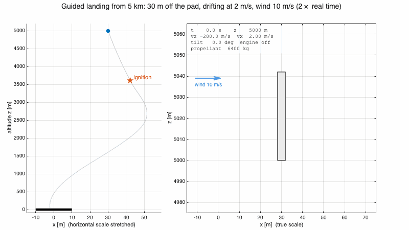

*One guided landing from 5 km, starting 30 m off the pad and drifting away at
2 m/s in a 10 m/s wind, at twice real time. Left: the whole descent, with the
horizontal scale stretched. Right: a window that follows the stage at true
scale, with the plume along the gimbal direction and proportional to the
thrust. It touches down 1.7 m from the centre at 1.2 m/s.*

**Key results**

- **1000 of 1000** dispersed landings meet every touchdown requirement (95 %
  interval 99.6–100 %), with 99th percentiles of **1.9 m** from the pad,
  **1.3 m/s** vertical and 0.2 m/s lateral speed; with every dispersion
  doubled, 98 % still land. A sudden thrust loss of **15 %** is survived at
  any time in the burn; an altimeter that reads more than **0.13 m** high is
  not.
- A constant-deceleration guidance law in feedback lands at **1.2 m/s**; adding
  a drag feedforward cuts the burn from 34 s to **25 s** and leaves **1686 kg**
  of propellant instead of 635, and an integral term keeps it landing with a
  thrust 10 % weaker than commanded.
- With the same gimbal and the same peak effort, an **LQR** on the coupled
  lateral and pitch states lands **0.004–0.19 m** from the pad against
  0.4–1.6 m for a cascaded PD; a **disturbance observer** that measures the
  wind force and cancels it halves the 99th-percentile miss (3.8 to 1.9 m) and
  cuts the lateral-speed failures under 2.5× dispersions from 41 to 7 of 300,
  where a lateral integral wound up.

## Contents

1. [Physics](#physics)
2. [Method](#method)
3. [Validation](#validation)
4. [Results](#results)
5. [Discussion and limitations](#discussion-and-limitations)
6. [Getting started](#getting-started)
7. [Repository layout](#repository-layout)
8. [Tests](#tests)
9. [Roadmap](#roadmap)
10. [References](#references)
11. [License](#license)

## Physics

### Equations of motion

The stage moves in a vertical plane: horizontal position $`x`$, altitude
$`z`$ above the pad, pitch $`\theta`$ measured from the vertical and positive
when the stage leans towards $`+x`$, and mass $`m`$. The engine produces a
thrust $`T`$ along the body axis, turned by the gimbal angle $`\delta`$, at a
distance $`l`$ below the centre of mass:

```math
m\ddot x = T\sin(\theta + \delta) - D_x, \qquad m\ddot z = T\cos(\theta + \delta) - mg - D_z
```

```math
I\ddot\theta = -T\,l\sin\delta, \qquad \dot m = -\frac{T}{I_{sp}\,g_0}
```

The minus sign in the pitch equation is the inverted pendulum: thrust applied
below the centre of mass pushes the tail one way and turns the nose the
other, so to tilt the stage towards $`+x`$ the gimbal must first turn towards
$`-x`$. Drag acts against the velocity relative to the air, with a constant
horizontal wind $`w`$ and an exponential atmosphere of scale height $`H`$:

```math
\mathbf D = \tfrac12\,\rho(z)\,C_D A\,\lVert\mathbf v_{rel}\rVert\,\mathbf v_{rel}, \qquad \mathbf v_{rel} = (\dot x - w,\ \dot z), \qquad \rho(z) = \rho_0\,e^{-z/H}
```

These are seven first-order states $`(x, z, \dot x, \dot z, \theta, \dot\theta, m)`$,
one Simulink integrator each; a single MATLAB Function computes their
derivatives, and the engine is cut when the mass reaches the dry mass.

### Why the landing is hard: the engine cannot hover

At its minimum throttle the engine still produces $`T_{min} = 338`$ kN, while
the empty stage weighs $`m_{dry} g = 251`$ kN: $`T_{min}/(m_{dry} g) = 1.35 \gt 1`$.
Even at minimum thrust the stage accelerates upwards, so it cannot stop in the
air and wait. It must reach zero velocity exactly when it reaches the ground,
the manoeuvre known as a hoverslam [6]. Light too early and it stops in
mid-air, climbs and falls back with empty tanks; too late and it hits the pad.

For a full-thrust burn the ignition altitude has a closed form. With
$`c = I_{sp} g_0`$ and $`\dot m = T_{max}/c`$, the rocket equation with
gravity gives the speed during the burn, and the burn time $`t_b`$ is the time
at which a stage falling at $`v_0`$ stops:

```math
0 = -v_0 - g\,t_b + c\ln\frac{m_0}{m_0 - \dot m\,t_b}
```

Integrating the velocity once more, with $`m_b = m_0 - \dot m\,t_b`$, gives the
distance covered during the burn, which is the ignition altitude:

```math
h = v_0 t_b + \tfrac12 g t_b^2 - c\left(t_b - \frac{m_b}{\dot m}\ln\frac{m_0}{m_b}\right)
```

From 280 m/s this is 2180 m and a 15.0 s burn, drag neglected. It is the
burn that uses the least propellant and keeps no margin at all: a thrust or
mass 3 % off ends in a 75 m/s impact.

### Pitch dynamics and dynamic inversion

For small gimbal angles the pitch equation is a double integrator whose gain
depends on the throttle:

```math
\ddot\theta = -K\,\delta, \qquad K = \frac{T\,l}{I}
```

$`K`$ changes by a factor of 2.5 between $`T_{min}`$ and $`T_{max}`$. Inverting
it [8], the controller chooses a pitch acceleration $`\ddot\theta_{cmd}`$ and
asks the gimbal for the angle that produces it:

```math
\delta_{cmd} = -\frac{I}{l\,\max(T, T_{min})}\,\ddot\theta_{cmd}
```

so that the loop sees $`\ddot\theta = \ddot\theta_{cmd}`$ at every throttle
setting; the $`\max`$ guards the division when the engine is off.

### Constant-deceleration guidance

A stage at altitude $`z`$ descending at speed $`u = -\dot z`$ reaches a target
speed $`u_t`$ at the ground under the constant deceleration

```math
a_{req} = \frac{u^2 - u_t^2}{2z}
```

from $`u^2 = u_t^2 + 2 a z`$. Differentiating with $`\dot z = -u`$ and
$`\dot u = -a`$, where $`a`$ is the deceleration actually achieved,

```math
\dot a_{req} = \frac{u}{z}\,\left(a_{req} - a\right)
```

If the stage decelerates exactly as required, $`a_{req}`$ stays constant. If
it decelerates more, for instance because drag helps, $`a_{req}`$ shrinks and
the burn stretches; if it decelerates less, $`a_{req}`$ grows, at a rate
$`u/z`$ that diverges near the ground. These two effects shape the guidance
law of the next section.

### Lateral motion

To move sideways the stage must lean. For small angles, and with the pitch
loop inverted so that $`\ddot\theta = u`$,

```math
\ddot x \approx a\,\theta, \qquad \ddot\theta = u, \qquad a = T/m
```

With the scaled states $`(x, \dot x, a\theta, a\dot\theta)`$ and the input
$`a u`$ this is a chain of four integrators, and slowly varying $`a`$ only
rescales it. A linear law on the four states, written as a pitch reference
for the attitude loop, then takes the form

```math
\theta_{ref} = -\frac{K_1 x + K_2 \dot x}{a} + K_3\,\theta + K_4\,\dot\theta
```

which serves both controllers compared in the results.

### Wind as a lateral disturbance

Everything the law above does not model enters the lateral equation as a
disturbance per unit mass $`d`$:

```math
\ddot x = a\sin\theta + d, \qquad d = -\frac{D_x}{m} + \frac{(k_T - 1)\,T_{cmd}}{m}\sin\theta + \frac{T}{m}\big(\sin(\theta + \delta) - \sin\theta\big)
```

with $`a = T_{cmd}/m`$ the acceleration the controller believes it commands
and $`k_T`$ the unknown ratio of actual to commanded thrust. The largest term
is the wind drag, and it is not constant: it scales with
$`\rho\,\lVert\mathbf v_{rel}\rVert\,(\dot x - w)`$, so it is largest early in
the burn, when the stage falls at 290 m/s through denser air, and vanishes at
touchdown, when the stage moves at 1 m/s. A proportional law leaves an error
proportional to $`d`$; an integral of the lateral error would remove a
*constant* $`d`$, but this one decays by an order of magnitude during the
burn, so the integral keeps pushing after the disturbance is gone.

Since every other term of the equation is measured or commanded, $`d`$ can
instead be measured directly [9]: subtract from the measured lateral
acceleration the part the controller explains, and low-pass filter the rest,
because a derivative amplifies measurement noise,

```math
\hat d = \frac{1}{\tau_{d}\,s + 1}\left[\ddot x - \frac{T_{cmd}}{m}\sin\theta\right]
```

The lateral law then asks for the extra tilt that cancels it, $`a\,\Delta\theta = -k_d\,\hat d`$:

```math
\theta_{ref} = -\frac{K_1 x + K_2 \dot x + k_d\,\hat d}{a} + K_3\,\theta + K_4\,\dot\theta
```

$`k_d = 0`$ gives back the law of step 4. The estimate lumps every
unmodelled lateral force together: the thrust error, and also the side force
of the gimbal itself, $`T\delta/m`$ for small angles, which the four-integrator
model leaves out.

## Method

### Vehicle

A Falcon 9-class first stage in its landing burn with one Merlin 1D lit. The
values marked *public* come from [1–3]; the others are derived and later
dispersed in the Monte Carlo.

| Quantity | Value | Source |
|---|---|---|
| maximum thrust $`T_{max}`$ | 845 kN | public [1] |
| minimum throttle | 40 % (338 kN) | public [1], sources range 40–57 % |
| specific impulse $`I_{sp}`$ | 282 s | public [1] |
| dry mass $`m_{dry}`$ | 25.6 t | public [3], with legs and grid fins |
| mass at ignition $`m_0`$ | 32 t | rocket equation for a 600 m/s braking budget |
| diameter, length | 3.66 m, 42 m | public [2] |
| drag coefficient $`C_D`$ | 0.8 | estimate, blunt body flying base first |
| gimbal-to-CoM distance $`l`$ | 16 m | estimate, 6 t of engines at the base |
| pitch inertia $`I`$ | 4.8×10⁶ kg m² | estimate, rod plus parallel-axis terms |
| gimbal limit, rate, lag | 5 deg, 10 deg/s, 0.1 s | assumed |
| initial state | 5 km, −280 m/s | close to the 320 m/s terminal speed at 5 km |

Every value lives in `params.m`; the Simulink blocks read the struct `p` and
contain no numbers.

### Models

| Model | Content |
|---|---|
| `plant_vertical.slx` | the vertical channel, $`\ddot z = T/m - g`$, built first to learn Simulink |
| `plant_3dof.slx` | the seven-state plant; inputs $`T`$ and $`\delta`$, seven outputs |
| `attitude_ctrl.slx` | Subsystem Reference: PD on $`\ddot\theta_{cmd}`$, the inversion, the gimbal servo |
| `attitude_loop.slx` | the plant (Model block) closed by `attitude_ctrl`, for step 2 |
| `landing.slx` | the plant, `attitude_ctrl`, the vertical guidance, the lateral control with the disturbance observer, the injected failures and the sensors, laid out in one area per group |

The plant is referenced, not copied, so one correction reaches every model.

### Attitude loop

A PD on the commanded pitch acceleration, $`\ddot\theta_{cmd} = K_p(\theta_{ref} - \theta) - K_d\,q`$,
inverted as above, gives the closed loop $`s^2 + K_d s + K_p`$ at every
throttle. $`\omega_n = 1`$ rad/s and $`\zeta = 0.7`$ ($`K_p = 1`$ s⁻²,
$`K_d = 1.4`$ s⁻¹): a 5 deg error then asks for 0.087 rad/s², within the
0.098 rad/s² the gimbal can give at minimum thrust. There is no integral term:
the model has no constant pitch disturbance for it to reject.

The gimbal is a first-order servo, $`\dot\delta = \mathrm{sat}_{\pm 10^\circ/\mathrm s}\big((\delta_{cmd} - \delta)/\tau\big)`$
with $`\delta_{cmd}`$ clipped to ±5 deg. Simulink's Rate Limiter block was
tried first and rejected: in continuous time it passes its first input
through, so the gimbal jumped to its limit at $`t = 0`$.

### Vertical guidance

The engine lights when $`a_{req}`$ reaches a design deceleration
$`a^* = \eta\,(T_{max}/m_0 - g)`$, a fraction $`\eta`$ of the maximum available.
After ignition the thrust command is

```math
T = \mathrm{sat}_{[T_{min},\,T_{max}]}\Big(m\,(g + a_{req} + a_I) - \hat D\Big), \qquad \hat D = \tfrac12\rho(z)\,\hat C_D A\,\dot z^2, \qquad a_I = K_i\!\int (a_{req} - a^*)\,dt
```

| Choice | Value | Reason |
|---|---|---|
| $`\eta`$ | 0.7 | about 20 % of throttle left for errors at ignition; with $`\eta = 1`$ a 3 % thrust or mass error crashes at 75 m/s |
| target touchdown speed $`u_t`$ | 1 m/s | keeps $`a_{req}`$ finite at the end; the requirement is 2 m/s |
| drag feedforward $`\hat D`$ | nominal $`\hat C_D = 0.8`$ | without it drag over-brakes the stage and $`a_{req}`$ keeps shrinking: a 34 s burn and 635 kg left instead of 25 s and 1686 kg |
| integral term $`K_i`$ | 1 s⁻¹ | with the feedforward alone a thrust 5 % low lands at 2.4 m/s, because $`a_{req}`$ grows like $`u/z`$; 0.3 s⁻¹ relights the engine with $`C_D = 1.2`$ |
| ignition logic | relay, on at $`a^*`$, off at $`0.1\,a^*`$ | the hysteresis prevents the engine from switching on and off around $`a^*`$ |

The integral only runs while the engine is lit. In the nominal case
$`a_{req}`$ then stays at $`a^* = 11.6`$ m/s² for the whole burn, which is the
planned constant deceleration.

### Lateral control

The two controllers share the actuator, the scenarios and the metrics; they
differ only in the four gains of $`\theta_{ref}`$:

| | $`K_1`$ | $`K_2`$ | $`K_3`$ | $`K_4`$ | Design |
|---|---|---|---|---|---|
| cascaded PD | 0.040 | 0.360 | 0 | 0 | outer loop on $`x`$ at 0.2 rad/s, one fifth of the attitude loop, $`\zeta = 0.9`$ |
| LQR | 0.043 | 0.306 | 0.035 | 0.011 | Bryson weights [4] (10 m, 4 m/s, 3 deg), $`R`$ set for the same peak effort as the PD |

The LQR is solved on the scaled chain and converted to the same form: from
$`u = -K_n s`$ and $`u = K_p(\theta_{ref} - \theta) - K_d q`$,
$`K = [K_{n1},\ K_{n2},\ K_p - K_{n3},\ K_d - K_{n4}]/K_p`$. Textbook weights
first produced gains asking for 25 times the gimbal authority, so the
comparison is made at equal peak effort. With the engine off the lateral
control asks for $`\theta = 0`$, and $`\theta_{ref}`$ is limited to ±10 deg.

The disturbance observer is built in `landing.slx` from a Derivative block on
$`\dot x`$, the term $`(T_{cmd}/m)\sin\theta`$, and a first-order Transfer
Fcn; its output is the eighth input of `lateral_ctrl`. The PD and LQR
comparison is flown with it off, so that only the gains differ.

| Choice | Value | Reason |
|---|---|---|
| fraction cancelled $`k_d`$ | 1 | the touchdown speed is the requirement that fails first and the one that tips a stage over; a smaller $`k_d`$ leaves part of the wind, and how much depends on a wind the controller does not know |
| filter time constant $`\tau_d`$ | 0.5 s | a shorter filter lags the decaying wind less (3.9 m instead of 4.6 m of overshoot at 0.05 s), but the model has no sensor noise to show its cost: 0.05 m/s of noise at 10 Hz on $`\dot x`$ becomes about 3 m/s² once differentiated, which 0.5 s attenuates about 30 times and 0.05 s only 3 times |
| thrust in the estimate | $`T_{cmd}`$ | the actual thrust is unknown; the thrust error ends up in $`\hat d`$ and is cancelled with the wind |

### Monte Carlo

Each landing draws, from Gaussian distributions with seed 42:

| Dispersion | 1σ |
|---|---|
| thrust actual/commanded | 2 % |
| $`I_{sp}`$ | 1 % |
| mass at ignition | 300 kg |
| $`C_D`$ | 15 % |
| horizontal wind | 5 m/s |
| lateral position, lateral speed | 20 m, 2 m/s |
| vertical speed | 10 m/s |
| tilt | 1 deg |

The guidance and the controllers keep the nominal values. A landing succeeds
if it touches down within 120 s with $`\lvert\dot z\rvert \lt 2`$ m/s,
$`\lvert\dot x\rvert \lt 1`$ m/s, $`\lvert\theta\rvert \lt 5`$ deg,
$`\lvert x\rvert \lt 10`$ m and propellant left. The success rate is given
with the 95 % Wilson interval [7], which stays meaningful at 100 %:

```math
\frac{\hat p + \frac{z^2}{2n} \pm z\sqrt{\frac{\hat p(1 - \hat p)}{n} + \frac{z^2}{4n^2}}}{1 + \frac{z^2}{n}}, \qquad z = 1.96
```

The 99 % ellipse is the covariance ellipse of the touchdown state
$`(x, \dot z)`$ scaled by $`\sqrt{\chi^2_{2}(0.99)} = 3.03`$. The stress test
repeats the Monte Carlo with every 1σ multiplied by 1 to 4, 300 landings each.

### Failure injection

The dispersions above are constant through the flight. A failure is a change
during the flight, or a measurement the controllers trust and should not.
Three are injected into `landing.slx`, one at a time, all off by default:

| Failure | Injected as | Parameters |
|---|---|---|
| sudden thrust loss | $`T = k_T\,(1 - f\,\mathbf{1}[t \ge t_f])\,T_{cmd}`$, a Step block after the thrust error | `p.fail.dT`, `p.fail.tT` |
| altimeter bias | the guidance reads $`z_m = z + h_b`$ | `p.fail.zBias` |
| lateral velocity drift | the lateral law and the observer read $`\dot x_m = \dot x + b\,t`$, the drift of an integrated accelerometer bias | `p.fail.vxDrift` |

None of them is reported to the guidance. Two closed forms frame the results.
If the stage could follow its plan after a thrust loss, it would survive any
loss that the nominal thrust of the rest of the burn leaves room for,
$`f \lt 1 - \max_{t \ge t_f} T(t)/T_{max}`$. With an altimeter reading $`h_b`$
too high, the guidance brings the stage to $`u_t`$ where it believes the ground
is, and the real ground arrives $`h_b`$ earlier, still at the planned
deceleration $`a^*`$:

```math
v_{impact} = \sqrt{u_t^2 + 2a^*h_b} \lt v_{req} \quad\Longleftrightarrow\quad h_b \lt \frac{v_{req}^2 - u_t^2}{2a^*} = 0.13\ \mathrm{m}
```

An altimeter that reads too low stops the stage above the ground, where an
engine that cannot hover has to cut and relight.

## Validation

No model is used before it reproduces closed-form solutions, each of which
switches on a single term of the dynamics.

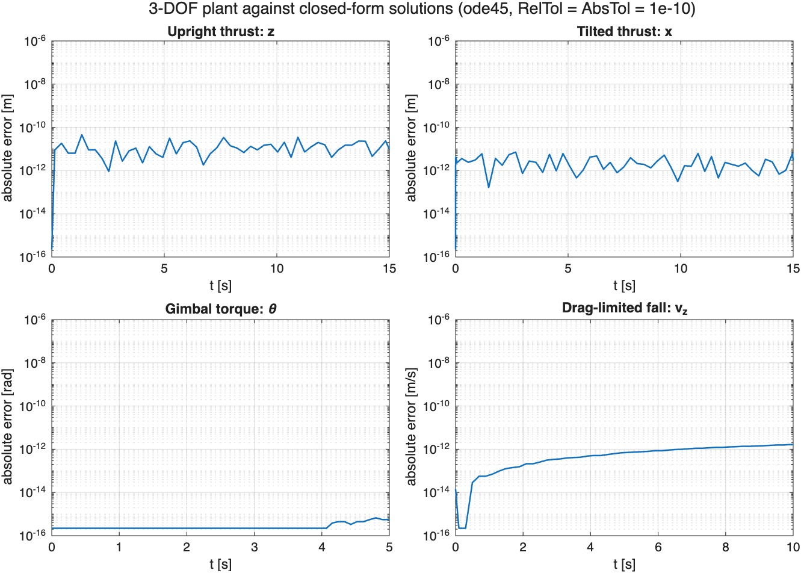

| Case | Closed form | Maximum error |
|---|---|---|
| free fall | $`z = z_0 + \dot z_0 t - \tfrac12 g t^2`$ | 6×10⁻¹² m (round-off: ode45 integrates a quadratic exactly) |
| constant thrust, upright | rocket equation with gravity | 4.5×10⁻¹¹ m (solver tolerance 10⁻¹⁰) |
| fixed tilt, no gravity | rocket equation along $`\theta_0`$ | 7.2×10⁻¹² m |
| constant gimbal | $`\theta = \theta_0 - \tfrac12 (T l \sin\delta / I)\,t^2`$ | 6.7×10⁻¹⁶ rad |
| unpowered fall, constant density | $`\dot z = -v_t\tanh\!\big(g t / v_t + \mathrm{artanh}(\lvert\dot z_0\rvert / v_t)\big)`$ | 1.6×10⁻¹² m/s |
| body in a wind, no gravity | $`\dot x - w = (\dot x_0 - w)/(1 + k_d\lvert\dot x_0 - w\rvert t)`$ | 9×10⁻¹⁴ m/s |
| hoverslam ignition | lit at Tmax at $`h`$, the stage is at rest at $`t_b`$ | 4×10⁻¹⁰ m, 1.3×10⁻⁴ m/s |

The tests were themselves checked by injecting bugs into a reference model:
sine and cosine swapped, a flipped torque or drag sign, a missing ½, gravity
missing from the thrust command, a flipped lateral sign. Each makes the test
written for it fail.

The baselines of the results are the open-loop descents (no burn, and full
thrust from 5 km), the full-thrust hoverslam, and, for lateral control, the
cascaded PD flown with the same actuator and the same peak effort as the LQR.

## Results

### Without guidance, every descent crashes

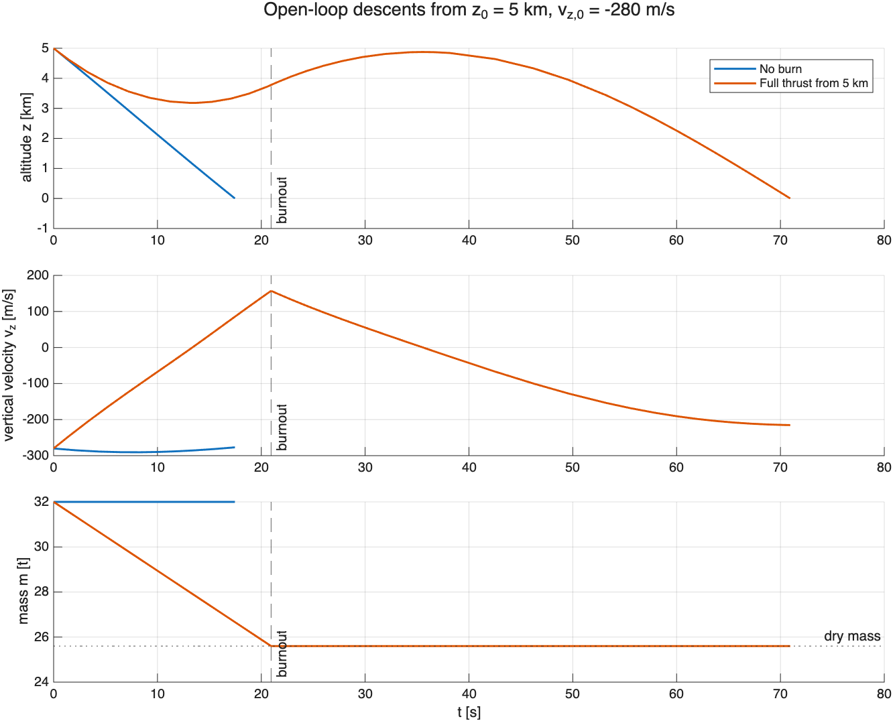

With no burn the stage hits the ground after 17 s at **277 m/s**. With full
thrust from 5 km it stops at 3.2 km, climbs back to 4.9 km, runs out of
propellant after 21 s and lands at **215 m/s**.

### Attitude loop

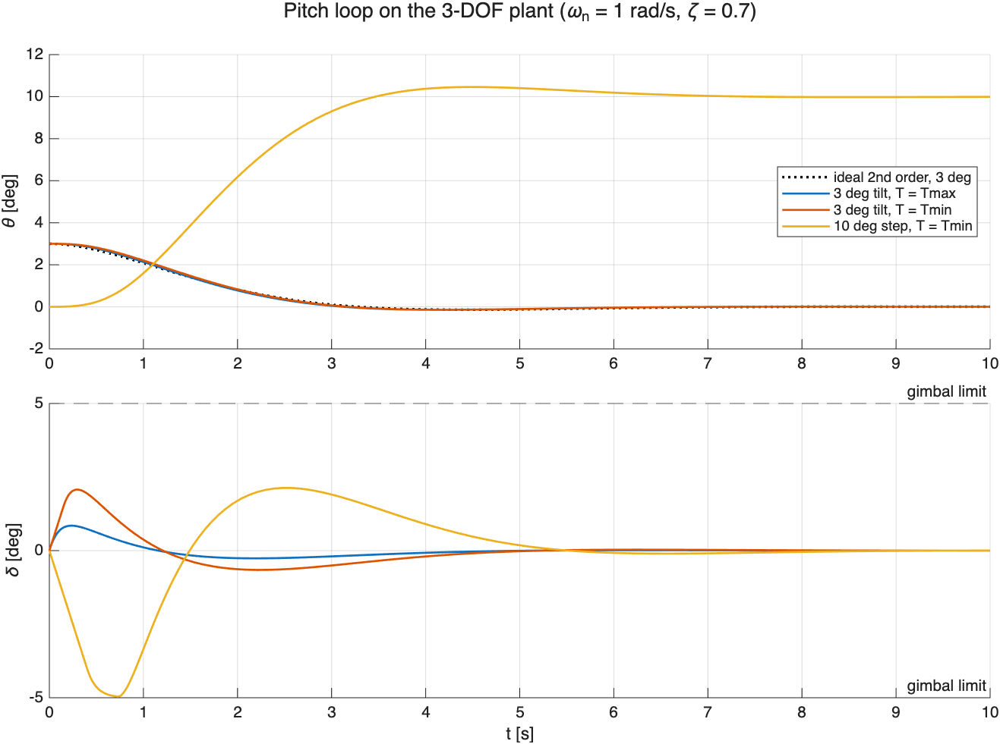

| | Value |
|---|---|
| phase margin, crossover | 56 deg at 1.53 rad/s (gimbal lag included) |
| delay margin | 0.64 s |
| 3 deg tilt, within 0.5 deg | 2.3 s at $`T_{max}`$, 2.5 s at $`T_{min}`$ |
| 10 deg step at $`T_{min}`$, gimbal saturated | 3.1 s |

The responses at full and minimum thrust overlap the ideal second-order
curve: the inversion removes the throttle dependence. The gain margin is
infinite only because the gimbal is modelled as a first-order lag; the delay
margin is the meaningful number. The margins are in
[`attitude_margins.png`](figures/attitude_margins.png).

### Guided landing

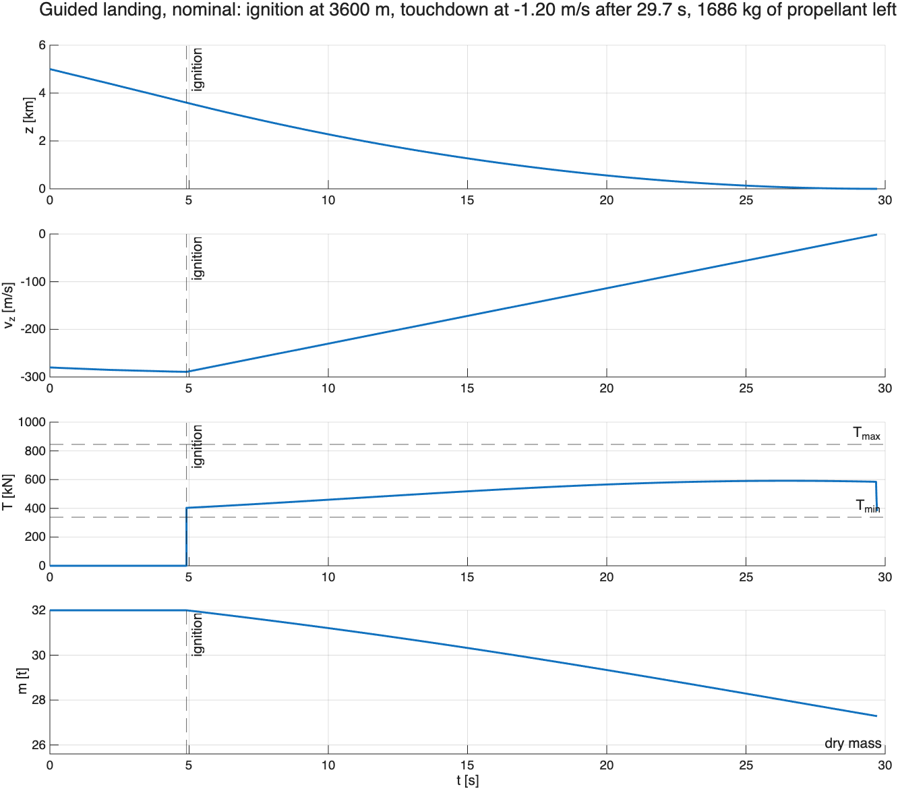

The engine lights at 3600 m, the vertical speed falls linearly, which is the
constant deceleration, and the stage touches down at **1.20 m/s** after a
**25 s** burn with **1686 kg** of propellant left. The thrust rises during the
burn, from 400 to 590 kN: early on, at 290 m/s, drag does much of the braking.

| Errors unknown to the guidance | Ignition | Touchdown | Propellant left |
|---|---|---|---|
| none | 3600 m | 1.20 m/s | 1686 kg |
| thrust −5 % | 3600 m | 1.20 m/s | 1692 kg |
| thrust −10 % | 3600 m | 1.20 m/s | 1699 kg |
| $`C_D`$ = 0.4 | 3912 m | 1.33 m/s | 1071 kg |
| $`C_D`$ = 1.2 | 3117 m | 1.15 m/s | 2263 kg |
| $`I_{sp}`$ −5 % | 3600 m | 1.20 m/s | 1460 kg |
| thrust −5 %, $`C_D`$ 0.4, $`I_{sp}`$ −5 % | 3912 m | 1.38 m/s | 818 kg |

The engine lights once in every case and the thrust stays within its limits
([`landing_dispersions.png`](figures/landing_dispersions.png)).

### Lateral control: cascaded PD against LQR

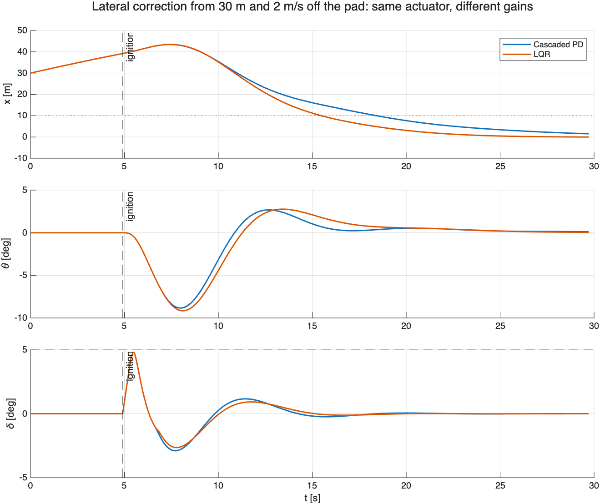

From four lateral errors (±30 m with ±2 m/s, 50 m, 3 m/s), each nominal and
with combined errors, both controllers meet every requirement, where the
uncontrolled stage misses the pad by 50–79 m:

| | Cascaded PD | LQR |
|---|---|---|
| miss at touchdown | 0.4–1.6 m | **0.004–0.19 m** |
| time to $`\lvert x\rvert \lt 1`$ m after ignition | 21–26 s | **15–18 s** |
| peak tilt | 6.5–8.8 deg | 6.2–9.2 deg |
| peak gimbal, propellant | same | same |

The first seconds after ignition are identical, because both controllers
drive the gimbal to its limit; the difference is in the tail, where the LQR's
small feedback of $`\theta`$ and $`q`$ into the lateral law coordinates the two
loops that the cascade keeps apart by bandwidth.

### Wind: the disturbance observer

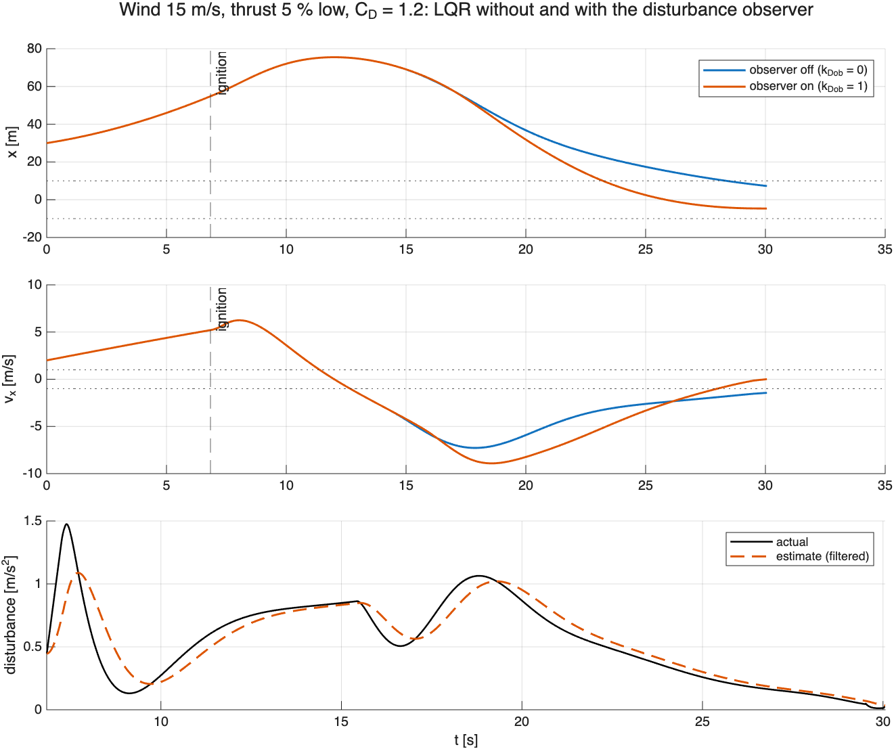

The case of the figure starts 30 m off the pad and drifting away at 2 m/s,
with a 15 m/s wind, a thrust 5 % low and $`C_D = 1.2`$. Before ignition the
wind has already pushed the stage to 55 m and 5.2 m/s. Without the observer it
lands 7.6 m off still drifting at **1.46 m/s**, which fails the 1 m/s
requirement; with it, it lands 4.6 m on the other side at **0.02 m/s**:

| Case (LQR) | observer off | observer on |
|---|---|---|
| 30 m, 2 m/s, wind 15 m/s, thrust −5 %, $`C_D`$ 1.2 | 7.60 m, −1.46 m/s (fails) | −4.64 m, −0.02 m/s |
| 30 m, wind +25 m/s | 7.28 m, −0.91 m/s | −3.13 m, 0.24 m/s |
| 30 m, wind −25 m/s | −7.26 m, 0.85 m/s | 2.27 m, −0.05 m/s |
| 30 m, 2 m/s, no wind | −0.02 m, −0.03 m/s | −0.44 m, 0.13 m/s |

The estimate (bottom panel) follows the disturbance with the lag of its
filter. The two trajectories coincide until 15 s because the commanded tilt
sits at its 10 deg limit from 10 to 15 s, which clips the observer's term.
After that, as the stage slows and the wind force decays, the estimate is
still slightly above the actual value, so the stage is pushed past the pad:
that is the 4.6 m on the other side. Without wind the observer costs 0.4 m,
because it also feeds back the gimbal's own side force.

Sweeping the two parameters on the same case, with the *worst margin* being
the smaller of $`1 - \lvert x\rvert/10\,\mathrm{m}`$ and $`1 - \lvert\dot x\rvert/1\,\mathrm{m/s}`$:

| $`k_d`$ | 0 | 0.25 | 0.5 | 0.75 | 1 |
|---|---|---|---|---|---|
| miss | 7.60 m | 4.71 m | 1.70 m | −1.42 m | −4.64 m |
| lateral speed | −1.46 m/s | −1.12 m/s | −0.76 m/s | −0.40 m/s | −0.02 m/s |
| worst margin | −46 % | −12 % | 24 % | **60 %** | 54 % |

| $`\tau_d`$ | 0.05 s | 0.2 s | 0.5 s | 1 s | 2 s |
|---|---|---|---|---|---|
| miss | −3.88 m | −4.14 m | −4.64 m | −5.38 m | −6.43 m |
| lateral speed | −0.01 m/s | −0.01 m/s | −0.02 m/s | −0.08 m/s | −0.27 m/s |

On this single case $`k_d = 0.75`$ has the larger worst margin, because it
under-corrects just enough to cancel the overshoot. It was not kept: the
amount it under-corrects is a fixed fraction of a wind the controller does not
know, so the right value changes with the wind. Flown on the dispersed
landings, $`k_d = 0.75`$ and $`k_d = 1`$ are within two runs of each other
under 2× and 3× dispersions (291 against 293 and 254 against 256 of 300), so
the full cancellation was kept.

### Monte Carlo and stress test

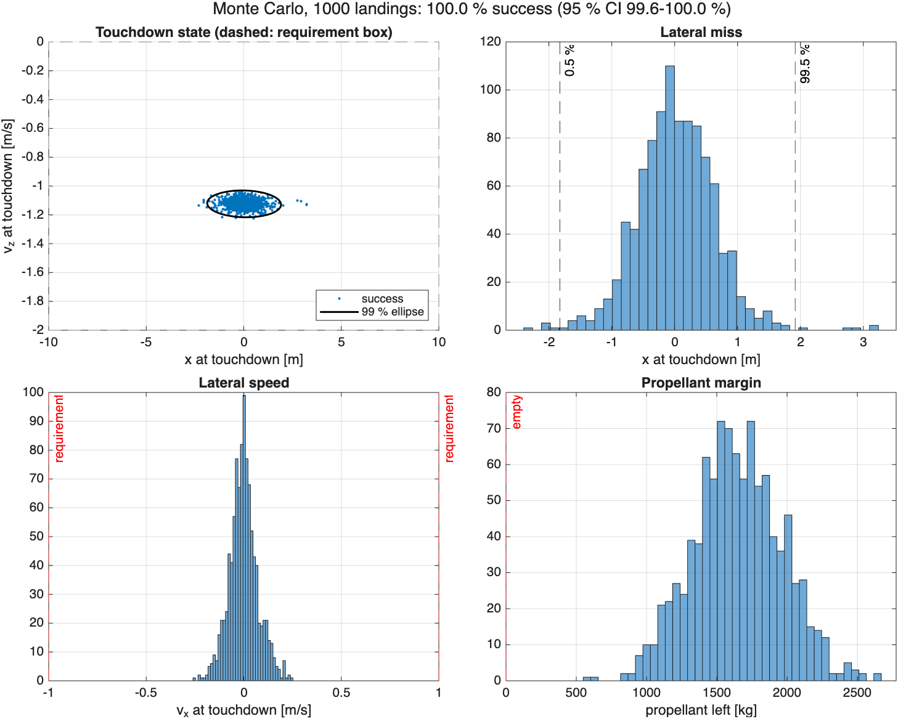

*1000 guided landings with dispersed thrust, Isp, mass, drag, wind and initial
state: touchdown state with its 99 % covariance ellipse (top left), lateral
miss, lateral speed and propellant left.*

On 1000 dispersed landings all succeed: 95 % interval
99.6–100 %. At the 99th percentile the stage lands 1.88 m from the pad at
1.28 m/s vertical and 0.21 m/s lateral speed, tilted 0.09 deg; the least
propellant left is 583 kg. Without the observer the same draws give 3.84 m and
0.59 m/s. The spread of the miss settles at 0.65 m after 300–500 runs
([`montecarlo_convergence.png`](figures/montecarlo_convergence.png)), against
1.35 m without the observer.

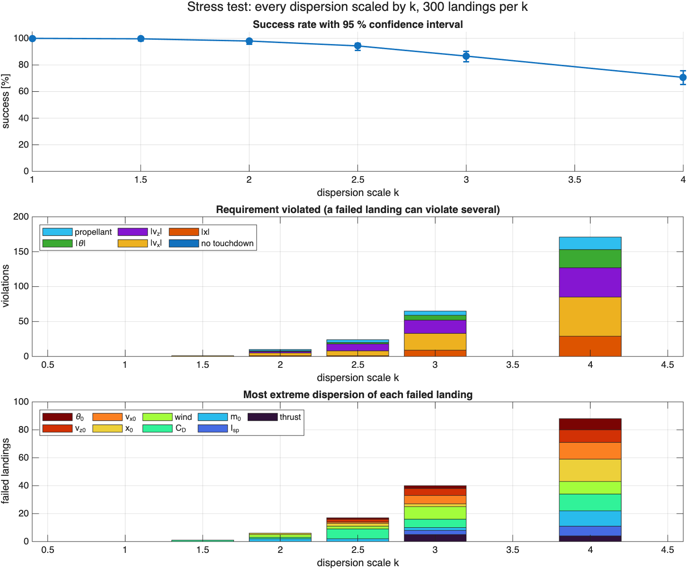

| Dispersions | ×1 | ×1.5 | ×2 | ×2.5 | ×3 | ×4 |
|---|---|---|---|---|---|---|
| success, observer on | 100 % | 99.7 % | 98 % | 94 % | 87 % | 71 % |
| success, observer off | 100 % | 99 % | 95 % | 83 % | 80 % | 57 % |
| lateral-speed failures, on / off | 0 / 0 | 1 / 3 | 4 / 12 | 7 / 41 | 24 / 46 | 56 / 96 |

Without the observer the lateral speed at touchdown was the first requirement
to fail at every level, and the most extreme draw among the early failures was
most often the wind. With it, the lateral failures drop by a factor of 2 to 6;
from 2.5× the vertical speed fails as often (10 runs at 2.5×, unchanged by the
observer), so the vertical guidance becomes the limit, and no single
dispersion dominates the failures any more. Running out of propellant appears
only from twice the nominal dispersions.

### Failures

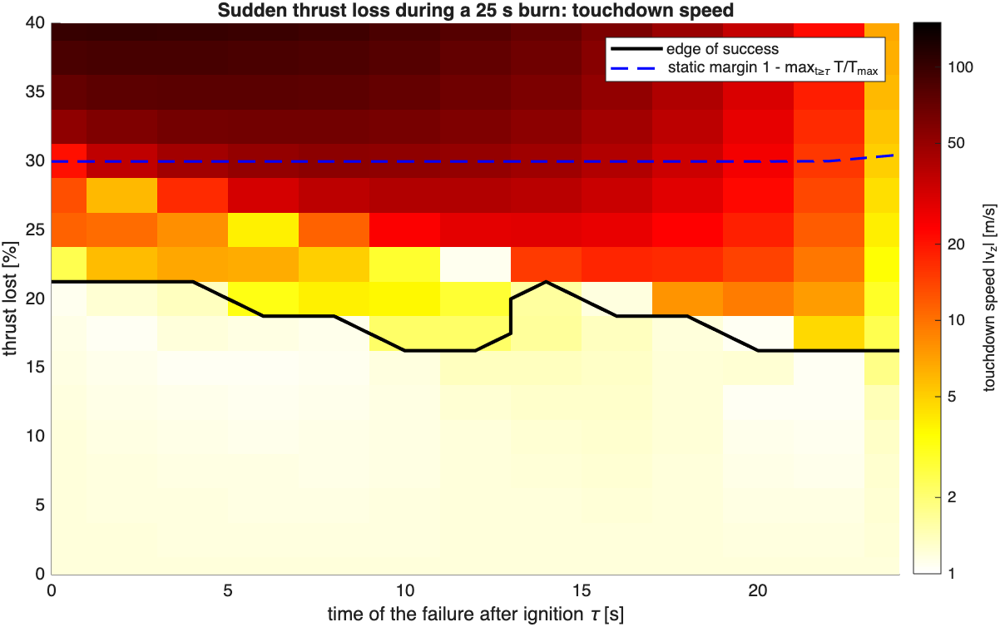

A thrust loss of up to **15 %** is survived whenever it happens, and up to
20 % in the first 4 s after ignition and around 14 s. The static margin, the
loss that the thrust of the rest of the burn leaves room for, is 30 %: half
of it is spent because after the loss the stage falls behind its plan, and the
required deceleration grows like $`u/z`$ as it approaches the ground. The
edge of success is ragged rather than a clean band, so a single number for
the thrust margin would overstate what is known.

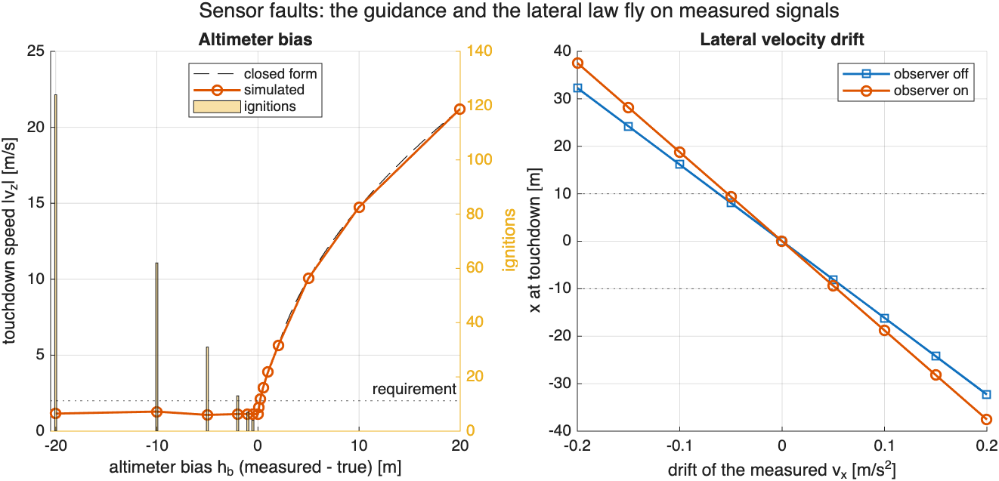

| Altimeter bias | −20 m | −2 m | −0.5 m | 0 | +0.1 m | +0.25 m | +1 m | +10 m |
|---|---|---|---|---|---|---|---|---|
| touchdown speed | 1.10 m/s | 1.36 m/s | 1.25 m/s | 1.20 m/s | 1.82 m/s | 2.61 m/s | 4.92 m/s | 15.3 m/s |
| ignitions | 89 | 11 | 4 | 1 | 1 | 1 | 1 | 1 |

A positive bias follows the closed form within 1 %: the guidance has no
altitude margin at all, and the altimeter must be good to about 0.1 m at the
end of the descent. A negative bias lands softly, but by switching the engine
on and off, 4 times for half a metre and 89 times for 20 m, burning 1500 kg of
extra propellant; a real engine allows a handful of relights at most.

A drift $`b`$ of the measured lateral velocity moves the touchdown point by
about 160 m per m/s² without the observer and 186 m per m/s² with it, so the
requirement of 10 m holds up to 0.054 m/s² with the observer (5.5 mg if the
drift comes from an accelerometer bias). The miss comes mostly from the
lateral law itself: it takes the false velocity $`b\,t`$ for a real drift and
steers against it until the position error balances it,
$`K_1 x \approx -K_2\,b\,t`$, which gives 21 m at the 30 s touchdown for
0.1 m/s²; the simulation gives 16 m, because the balance is never fully
reached. The observer, which differentiates the same measurement and reads
$`b`$ as a constant disturbance, adds 16 % to the miss.

## Discussion and limitations

The guidance holds because it is in feedback: it does not need to know the
thrust, the drag or the Isp, only the measured altitude, speed and mass. What
mattered most was not making it land but making it land well: the first
version touched down safely while wasting a ton of propellant, and only
looking at how it landed showed that drag was over-braking it. Removing that
waste exposed a sensitivity to thrust errors that the waste had been hiding,
which an integral term fixed. The dynamic inversion is what lets one set of
gains work from full to minimum thrust, in pitch and laterally.

The comparison of step 4 needed a change of scope. On pitch alone the LQR of a
double integrator is a PD, so the comparison was moved to the coupled lateral
and pitch states, where the LQR's advantage is real but modest: both are four
gains on a linear chain, and the LQR chooses them with weights in physical
units instead of separating bandwidths.

The first version of this README misread the stress test. It said that a
proportional lateral loop leaves a residual drift under a constant wind, and
that an integral term on the lateral error was the fix. The wind is constant,
but its force is not: it follows the airspeed squared, about 0.7 m/s² early in
the burn and nearly zero at the ground, so with a 25 m/s wind the stage
landed 7.3 m off still moving at 0.9 m/s, not settled at an offset. Tried on a
copy of the model, a lateral integral wound up during the long saturated phase
and missed the pad by 33 m ($`K_I = 0.005`$) to 105 m ($`K_I = 0.02`$); integrating
only near the pad did not help against the wind and degraded the landings
from a plain offset. The disturbance observer measures the force instead of
integrating its effect, so it follows a disturbance that changes during the
burn, and with the commanded thrust in the estimate it also absorbs the
thrust error.

The observer is not free. Its estimate contains every unmodelled lateral
force, including the side force of the gimbal itself, so it couples the
lateral law to the attitude loop: in a wind-free landing it costs 0.4 m, and a
faster attitude loop would have to be checked again with the observer in the
loop. It differentiates a velocity, so with real sensors its filter would set a
trade-off between lag and noise that this model, without sensor noise, cannot
show. A drifting velocity measurement is read as a disturbance and cancelled,
but the failure study shows that this adds only 16 % to the miss that the
lateral law itself makes on the same measurement. The tilt limit still clips
its correction in the hardest cases.

The failure study moves the weak point from the controllers to the
measurements. The guidance tolerates thrust errors well, 15 % lost at any
time, because it is in feedback, but the same feedback trusts the altitude
completely: aiming at 1 m/s exactly at $`z = 0`$ leaves no room for an altimeter
error of more than 0.13 m. Aiming at a gate a few metres above the ground and
descending the rest at constant speed, as real landers do, would buy that
margin with a little propellant.

The model leaves out:

- out-of-plane motion: the 99 % ellipse is drawn in the touchdown state
  $`(x, \dot z)`$, not on the ground;
- an angle-of-attack-dependent drag and the aerodynamic pitching moment;
- throttle dynamics and the engine's response time;
- navigation: the controllers see the true state, with no sensor noise or
  estimator, which is what keeps the differentiation inside the observer
  harmless;
- the change of inertia and centre of mass as propellant burns;
- gusts and a wind profile with altitude.

None of this is new. Hoverslam landings fly operationally [6], and the
fuel-optimal problem with thrust bounds is solved in flight by convex
optimisation [5]; the guidance here is a simple feedback law, not an optimal
one. What the project adds is a model checked term by term, a guidance law
whose inefficiency and its fix are both measured, a like-for-like comparison
of two lateral controllers, a disturbance observer whose benefit and cost are
both measured, and a dispersion analysis that says where the design breaks.
Disturbance observers are standard in motion control [9].

## Getting started

### Installation

```bash
git clone https://github.com/LoreMonti/Booster_Landing.git
cd Booster_Landing
```

MATLAB with Simulink, the Control System Toolbox and the Statistics and
Machine Learning Toolbox. The results were produced with MATLAB R2026b
(26.2) on macOS. No C compiler is needed: every model runs in Normal mode.

### Usage

From the repository root in MATLAB:

```matlab
run_all              % regenerate every study and figure (about 13 minutes)
runtests('tests')    % the 34 tests
```

| Script | What it does |
|---|---|
| `run_all.m` | runs every study below and writes `figures/` |
| `studies/study_plant_validation.m` | plant against the closed-form solutions |
| `studies/study_openloop.m` | descents with no burn and with full thrust |
| `studies/study_attitude.m` | margins and time responses of the pitch loop |
| `studies/study_landing.m` | guided landings, nominal and with single errors |
| `studies/study_lateral.m` | cascaded PD against LQR; the LQR in a wind with and without the observer |
| `studies/study_montecarlo.m` | 1000 dispersed landings, convergence |
| `studies/study_stress.m` | dispersions scaled 1 to 4 times |
| `studies/study_animation.m` | the animated landing at the top of this README |
| `studies/study_failures.m` | thrust loss against time and size, altimeter bias, velocity drift |

As a library:

```matlab
addpath('models', 'utils');
p = params();
[h, tb] = hoverslam_ignition(p, 280);              % full-thrust ignition altitude
fprintf('Light at %.0f m, burn for %.1f s\n', h, tb);

[draws, out] = dispersed_landings(p, 20, 1, 1);    % 20 dispersed guided landings
fprintf('%d of 20 landed; worst miss %.2f m\n', sum(out.success), max(abs(out.x)));
```

## Repository layout

```
Booster_Landing/
├── README.md, ROADMAP.md, LICENSE
├── params.m                    # every parameter, dispersion and requirement
├── run_all.m                   # regenerates every figure
├── models/
│   ├── plant_vertical.slx      # vertical channel (step 1a)
│   ├── plant_3dof.slx          # planar 3-DOF plant, inputs T and delta
│   ├── attitude_ctrl.slx       # PD, dynamic inversion, gimbal servo (Subsystem Reference)
│   ├── attitude_loop.slx       # plant + attitude controller (step 2)
│   └── landing.slx             # plant + attitude + guidance + lateral control + observer + failures
├── utils/
│   ├── simulate_plant.m        # one open-loop run of the plant
│   ├── hoverslam_ignition.m    # closed-form full-thrust ignition altitude
│   └── dispersed_landings.m    # draws dispersions and flies landings
├── studies/                    # one script per study, each writes its figures
├── tests/                      # MATLAB unit tests, one class per model or feature
├── figures/                    # the figures and the animation of this README
└── results/                    # raw Monte Carlo draws, git-ignored
```

The models are Simulink files, which GitHub cannot display, so every number
in this README comes from a script in `studies/` that rebuilds it from
`params.m`. The plant and the attitude controller are referenced by the
larger models rather than copied, so a correction reaches every model at
once.

## Tests

```matlab
runtests('tests')
```

34 tests pin the invariants that would catch a silent error:

- **TestPlantVertical** (2): free fall and constant thrust against the rocket
  equation; a wrong gravity sign fails both.
- **TestPlant3DOF** (5): the term-by-term closed forms of the validation table;
  swapped sine and cosine, a flipped torque or drag sign, a missing ½ in the
  drag or drag on $`\dot x`$ instead of $`\dot x - w`$ each fail one.
- **TestAttitudeLoop** (4): tilt recovery at $`T_{max}`$ and $`T_{min}`$ along
  the ideal response, gimbal angle and rate limits on a saturating step, phase
  margin above 45 deg; a wrong thrust in the inversion or a missing rate limit
  fails them.
- **TestLanding** (10): the hoverslam altitude against the plant; every
  requirement, thrust limits and a single ignition, nominally and under six
  unknown errors; a nominal burn under 27 s with over 1500 kg left, which fails
  without the drag feedforward.
- **TestLateral** (7): from 30 m and 2 m/s off the pad, the uncontrolled stage
  misses by more than 50 m and both gain sets meet every requirement, nominally
  and with combined errors; a flipped sign or a missing $`1/a`$ fails all four.
  With a 15 m/s wind, a thrust 5 % low and $`C_D = 1.2`$, the stage lands
  drifting faster than 1 m/s with the observer off and meets every
  requirement with it on; a flipped sign of $`\hat d`$ fails the second.
- **TestFailures** (6): 10 s into the burn, a 15 % thrust loss still meets
  every requirement and a 30 % loss crashes, with the applied thrust never
  above the remaining fraction of $`T_{max}`$; a missing or inverted loss
  fails the second. An altimeter reading 1 m high, inside the terminal gate,
  hits the ground at the closed-form $`\sqrt{u_t^2 + 2a_g h_b}`$ within 5 %,
  one reading 0.25 m high still lands under 2 m/s, one reading 10 m low
  relights the engine, and a 0.1 m/s² drift of the measured $`\dot x`$ misses
  the pad, more with the observer than without; a flipped bias, the
  guidance integral left running below the gate, or the guidance, the
  lateral law or the observer reading the true state, fails one of them.

## Roadmap

How the project was built step by step, with what went wrong at each step, is
in **[ROADMAP.md](ROADMAP.md)**.

## References

1. Wikipedia, *SpaceX Merlin*: Merlin 1D sea-level thrust, throttle range and
   specific impulse.
2. Wikipedia, *Falcon 9 Full Thrust*: first-stage diameter and length.
3. Spaceflight101, *Falcon 9 v1.1 & F9R Launch Vehicle Overview*: first-stage
   inert mass with landing hardware.
4. A. E. Bryson & Y.-C. Ho, *Applied Optimal Control*, Hemisphere (1975)
5. B. Açıkmeşe & S. R. Ploen, *Convex Programming Approach to Powered Descent
   Guidance for Mars Landing*, J. Guid. Control Dyn. **30**, 1353 (2007)
6. L. Blackmore, *Autonomous Precision Landing of Space Rockets*, The Bridge
   **46**, 15 (2016)
7. E. B. Wilson, *Probable Inference, the Law of Succession, and Statistical
   Inference*, J. Am. Stat. Assoc. **22**, 209 (1927)
8. D. Enns, D. Bugajski, R. Hendrick & G. Stein, *Dynamic Inversion: an
   Evolving Methodology for Flight Control Design*, Int. J. Control **59**, 71
   (1994)
9. W.-H. Chen, J. Yang, L. Guo & S. Li, *Disturbance-Observer-Based Control
   and Related Methods — An Overview*, IEEE Trans. Ind. Electron. **63**, 1083
   (2016)

## License

MIT License, Lorenzo Monti. See [LICENSE](LICENSE).
